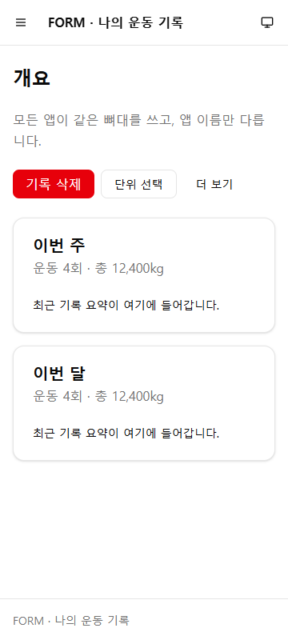
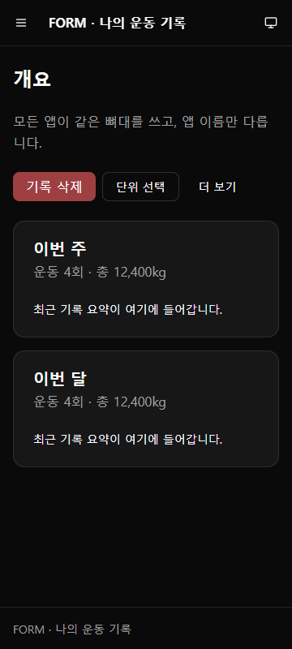
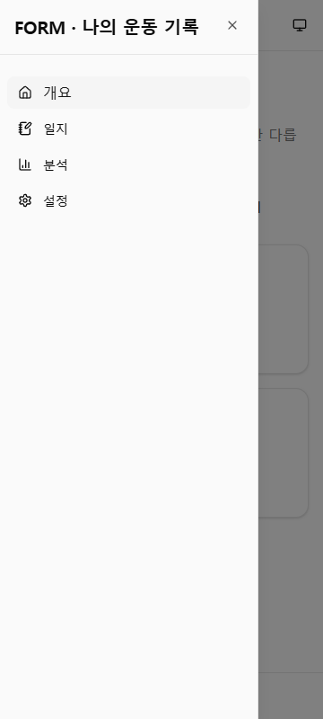
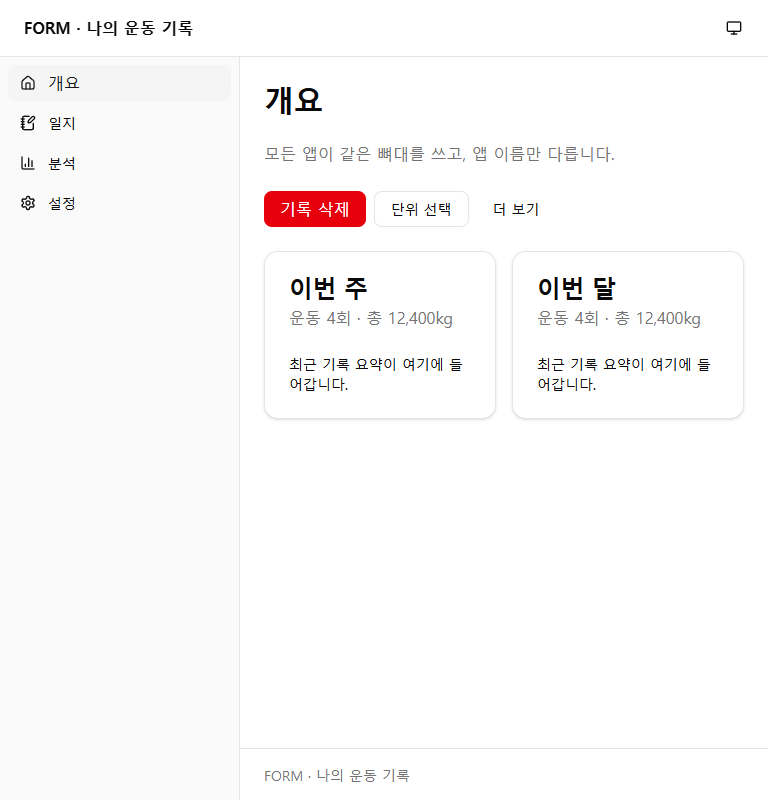
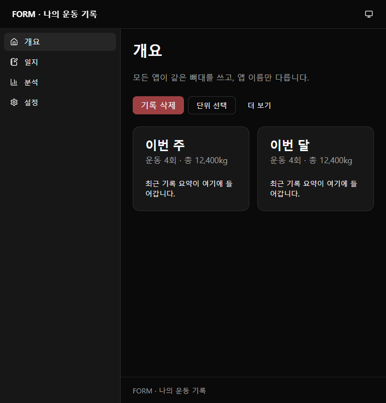
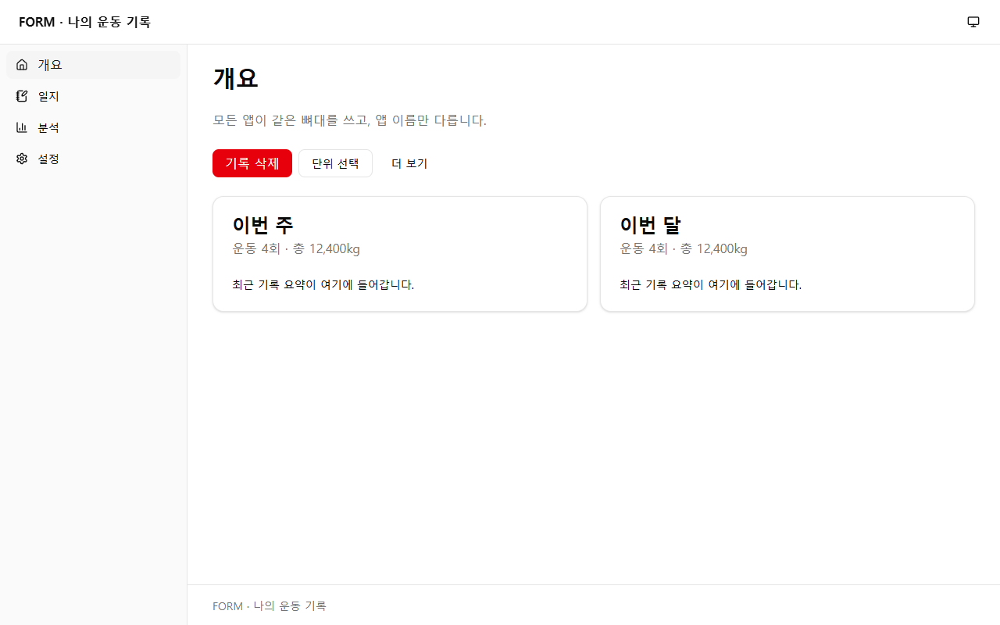
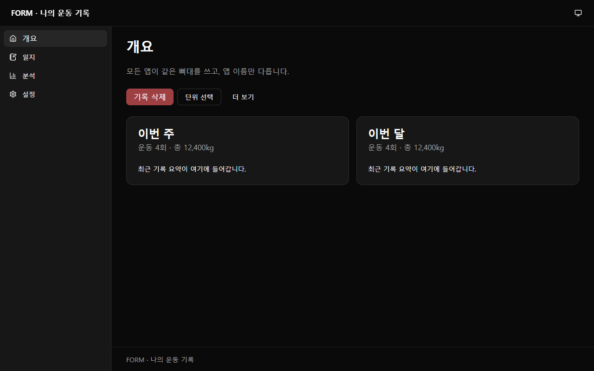

# 공통 레이아웃

8개 앱이 같은 화면 뼈대와 메뉴를 쓴다(#124). 앱마다 다른 것은 **앱 이름과 메뉴 항목**뿐이다. 원본은 `templates/ui/`이고 [공통 UI 컴포넌트](ui-components.md)와 함께 `features.ui`를 켠 앱에 동기화된다.

## 구성

| 파일 (앱 리포) | 내용 |
|---|---|
| `frontend/src/components/layout/app-shell.tsx` | `AppShell`: 상단 바, 주 메뉴(LNB), 본문(`<main id="main">`), footer, 본문 바로가기 링크 |
| `frontend/src/components/layout/theme-toggle.tsx` | 화면 모드 메뉴(시스템 설정·라이트·다크) |
| `frontend/src/lib/theme.ts` | 모드 읽기·적용·저장 (`localStorage`의 `theme`) |
| `frontend/public/theme-init.js` | 첫 화면을 그리기 전에 저장한 모드를 적용하는 스크립트 |
| `components/ui/dialog.tsx` | 모달 |
| `components/ui/sheet.tsx` | 화면 가장자리에서 나오는 패널(모바일 메뉴) |
| `components/ui/drawer.tsx` | 아래에서 올라오는 패널(vaul). 끌어내려 닫을 수 있다 |
| `components/ui/dropdown-menu.tsx` | 버튼에서 여는 메뉴 |

## 반응형 규칙

| 너비 | 배치 |
|---|---|
| 768px(`md`) 미만 | 상단 바 왼쪽의 "메뉴 열기" 버튼이 주 메뉴를 왼쪽 Sheet로 연다. 메뉴를 고르면 닫힌다 |
| 768px 이상 | 주 메뉴가 왼쪽 240px 사이드바로 고정된다. 본문은 남은 너비에서 `--content-max`까지 |

- **하단 탭은 쓰지 않는다.** 앱마다 메뉴 수가 달라서 하단 탭(보통 3–5개)으로 통일할 수 없고, Sheet 메뉴는 개수에 상관없이 같은 방식으로 동작한다. 자주 쓰는 동작은 페이지 안의 버튼으로 둔다.
- **노치 안전 영역:** 상단 바는 `env(safe-area-inset-top)`, 좌우는 `safe-area-inset-left/right`, footer와 Sheet·Drawer는 `safe-area-inset-bottom`만큼 띄운다. `index.html`의 `viewport-fit=cover`가 있어야 적용된다.
- 상단 바에는 앱 이름(첫 화면 링크), 앱별 동작(`actions`), 화면 모드 메뉴만 둔다. 페이지 제목(`h1`)은 각 페이지가 쓴다.

## 정한 것과 이유

- **shadcn/ui Sidebar 대신 `AppShell`:** Sidebar는 접기·아이콘 모드·쿠키 저장 등 기능이 많아 약 700줄이다. 앱에 필요한 것은 고정 사이드바와 모바일 Sheet뿐이라, 같은 토큰(`sidebar-*`)과 Sheet 컴포넌트로 짧게 만들었다.
- **NavigationMenu는 넣지 않았다.** 상단 바에 메뉴를 두지 않고 주 메뉴를 LNB 하나로 통일했기 때문이다. 필요해지면 중앙에 이슈를 연다.
- **Drawer는 열 때 포커스를 안으로 옮긴다.** vaul 1.1의 기본값은 포커스를 버튼에 남겨 두어, 키보드 사용자가 열린 drawer 밖으로 Tab 이동하게 된다. 우리 `Drawer`는 `autoFocus` 기본값을 `true`로 바꿨다.
- **깜빡임 방지 스크립트는 외부 파일이다.** `<head>` 맨 위의 일반 `<script src="/theme-init.js">`는 화면을 그리기 전에 실행된다. 인라인 스크립트를 쓰지 않아 나중에 CSP를 걸기 쉽다.

## 앱에 적용하기

새 앱은 스캐폴드가 모두 만든다. 기존 앱은 `features.ui`를 켤 때(#126) 다음을 한다.

1. 의존성: [공통 UI 컴포넌트](ui-components.md#앱에-켜기)의 패키지(`vaul` 포함, 사용자 승인, `--ignore-scripts`). `react-router`도 있어야 한다.
2. `frontend/index.html`의 `<head>` 맨 위(`<meta charset>` 바로 다음):
   ```html
   <script src="/theme-init.js"></script>
   ```
3. 앱 루트에서 `AppShell`로 페이지를 감싼다. 메뉴 항목은 `pages` 객체의 경로를 쓴다([디렉토리·라우팅 규칙](directory-rules.md)).
   ```tsx
   const nav: NavItem[] = [
     { to: pages.overview, label: '개요', icon: HomeIcon },
     { to: pages.journal, label: '일지', icon: NotebookPenIcon },
   ];
   <AppShell appName="<레지스트리 displayName>" nav={nav}>
     <Routes>…</Routes>
   </AppShell>
   <Toaster />
   ```
4. 화면 테스트 설정(`src/test/setup.ts`)에 `window.matchMedia` 대체 함수를 둔다. jsdom에는 없고, 토스트와 drawer가 읽는다(스캐폴드 참고).

## 확인한 결과 (2026-10-22)

가상 슬롯 99 앱(workout-memo 설치본 + 승인받은 패키지)으로 확인했다.

- 컴포넌트 테스트 37개, `tsc`, ESLint, `vite build` 통과
- Chrome 키보드 검사 12개 통과: 첫 Tab이 본문 바로가기, 메뉴 Sheet 열기·닫기와 포커스 복귀, 모달 안 Tab 순환과 Escape, drawer 열기(포커스 이동)·닫기, 드롭다운, 키보드로 다크 모드 전환, 새로고침 뒤 저장한 모드 유지, 현재 페이지 표시(`aria-current`)
- 가로 넘침: 360·768·1280px, 라이트·다크 모두 0px
- 글자 대비: 라이트 최소 4.74:1, 다크 최소 6.94:1

| | 라이트 | 다크 |
|---|---|---|
| 360px |  |  |
| 360px 메뉴 열림 |  | |
| 768px |  |  |
| 1280px |  |  |
