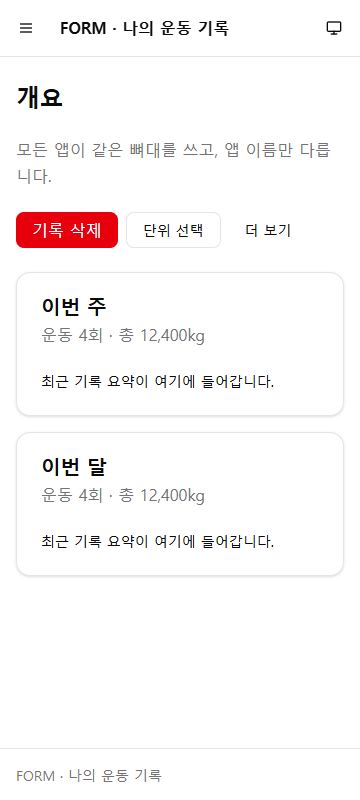
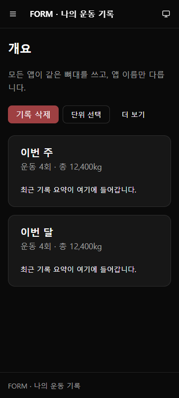
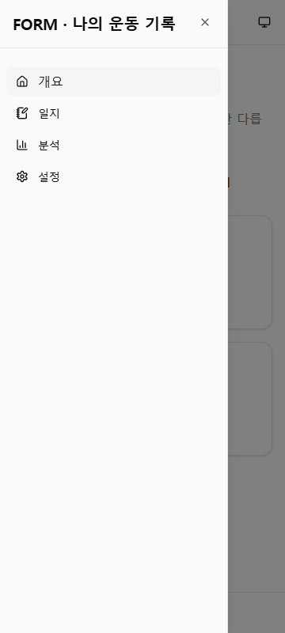
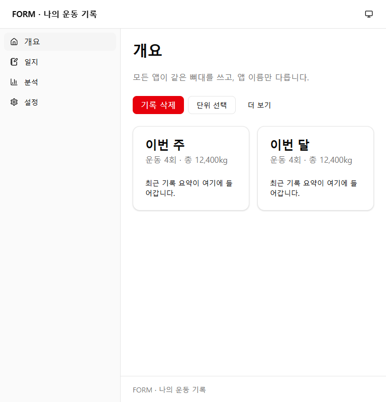
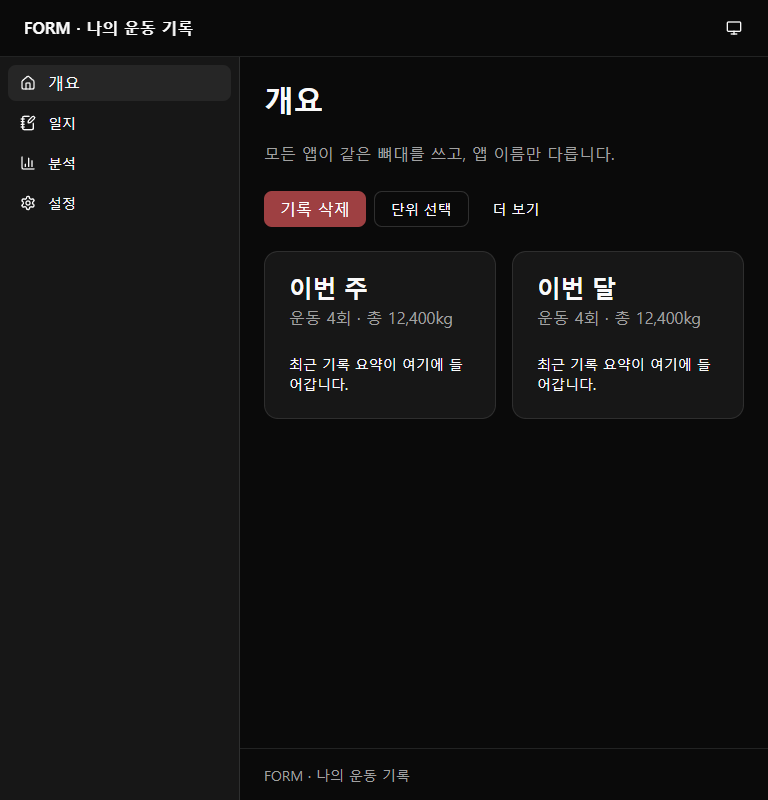
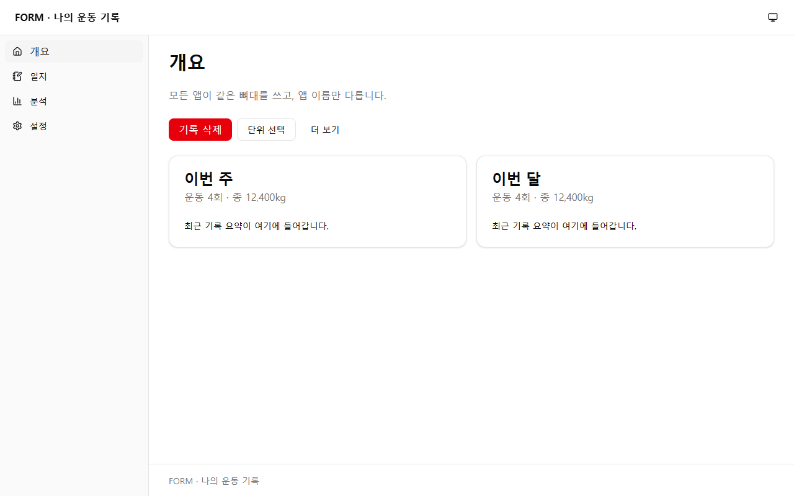
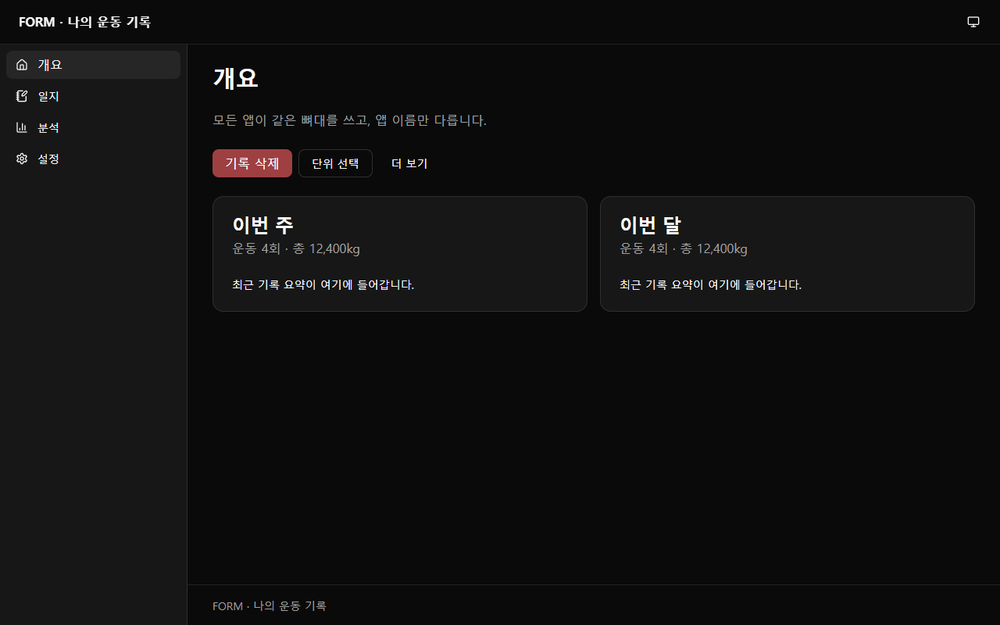

# Common Layout

All 8 apps use the same screen skeleton and menu (#124). The only things that differ per app are the **app name and menu items**. The source is `templates/ui/`, and it is synced, together with the [common UI components](ui-components.md), to apps that have `features.ui` turned on.

## Structure

| File (app repo) | Content |
|---|---|
| `frontend/src/components/layout/app-shell.tsx` | `AppShell`: top bar, main menu (LNB), body (`<main id="main">`), footer, skip-to-content link |
| `frontend/src/components/layout/theme-toggle.tsx` | Display mode menu (system setting, light, dark). `AppShell` does not render it in `darkOnly` apps |
| `frontend/src/lib/theme.ts` | Read, apply, and save the mode (`theme` in `localStorage`). In `darkOnly` apps, reading always returns `dark` |
| `frontend/src/lib/theme-config.ts` | The `DARK_ONLY` value rendered from the registry's `features.darkOnly` ([ADR-0011](adr/0011-dark-only-option.md)) |
| `frontend/public/theme-init.js` | A script that applies the saved mode before the first paint. `darkOnly` apps apply `dark` regardless of the saved value |
| `components/ui/dialog.tsx` | Modal |
| `components/ui/sheet.tsx` | A panel that slides in from a screen edge (mobile menu) |
| `components/ui/drawer.tsx` | A panel that slides up from the bottom (vaul). Can be dismissed by dragging down |
| `components/ui/dropdown-menu.tsx` | A menu opened from a button |

## Responsive rules

| Width | Layout |
|---|---|
| Below 768px (`md`) | The "Open menu" button on the left of the top bar opens the main menu as a left Sheet. Choosing a menu item closes it |
| 768px and above | The main menu is fixed as a 240px left sidebar. The body takes the remaining width up to `--content-max` |

- **No bottom tabs.** The number of menu items differs per app, so they cannot be unified into bottom tabs (usually 3–5), while the Sheet menu works the same way regardless of the count. Frequently used actions are placed as buttons inside the page.
- **Notch safe area:** The top bar is offset by `env(safe-area-inset-top)`, the left and right by `safe-area-inset-left/right`, and the footer and Sheet/Drawer by `safe-area-inset-bottom` only. This takes effect only when `viewport-fit=cover` is in `index.html`.
- The top bar holds only the app name (a link to the home screen), app-specific actions (`actions`), and the display mode menu. Each page writes its own page title (`h1`).

## What was decided and why

- **`AppShell` instead of the shadcn/ui Sidebar:** The Sidebar has many features, such as collapsing, icon mode, and cookie persistence, and is about 700 lines. The apps need only a fixed sidebar and a mobile Sheet, so it was built short with the same tokens (`sidebar-*`) and the Sheet component.
- **NavigationMenu was not included.** This is because the top bar holds no menu and the main menu is unified into a single LNB. If it becomes necessary, open an issue in the central repo.
- **Drawer moves focus inside when it opens.** The default in vaul 1.1 leaves focus on the button, so keyboard users Tab out of the open drawer. Our `Drawer` changes the `autoFocus` default to `true`.
- **The flash-prevention script is an external file.** A plain `<script src="/theme-init.js">` at the very top of `<head>` runs before the first paint. No inline script is used, so a CSP is easier to add later.

## Applying it to an app

The scaffold creates all of this for a new app. For an existing app, do the following when turning on `features.ui` (#126).

1. Dependencies: the packages from [common UI components](ui-components.md#turning-it-on-for-an-app) (including `vaul`, with user approval, `--ignore-scripts`). `react-router` must also be present.
2. At the very top of `<head>` in `frontend/index.html` (right after `<meta charset>`):
   ```html
   <script src="/theme-init.js"></script>
   ```
3. At the app root, wrap the pages with `AppShell`. Menu items use the paths from the `pages` object ([directory and routing rules](directory-rules.md)).
   ```tsx
   const nav: NavItem[] = [
     { to: pages.overview, label: 'Overview', icon: HomeIcon },
     { to: pages.journal, label: 'Journal', icon: NotebookPenIcon },
   ];
   <AppShell appName="<registry displayName>" nav={nav}>
     <Routes>…</Routes>
   </AppShell>
   <Toaster />
   ```
4. In the UI test setup (`src/test/setup.ts`), add a stand-in for `window.matchMedia`. jsdom does not have it, and toasts and the drawer read it (see the scaffold).

## Verified results (2026-10-22)

Verified with a virtual slot 99 app (workout-memo's installed copy + approved packages).

- 37 component tests, `tsc`, ESLint, and `vite build` pass
- 12 Chrome keyboard checks pass: the first Tab goes to the skip-to-content link, opening and closing the menu Sheet and focus return, Tab cycling inside a modal and Escape, opening the drawer (focus moves) and closing it, dropdown, switching to dark mode by keyboard, the saved mode persisting after reload, current page indication (`aria-current`)
- Horizontal overflow: 0px at 360, 768, and 1280px, in both light and dark
- Text contrast: minimum 4.74:1 in light, minimum 6.94:1 in dark

| | Light | Dark |
|---|---|---|
| 360px |  |  |
| 360px menu open |  | |
| 768px |  |  |
| 1280px |  |  |
