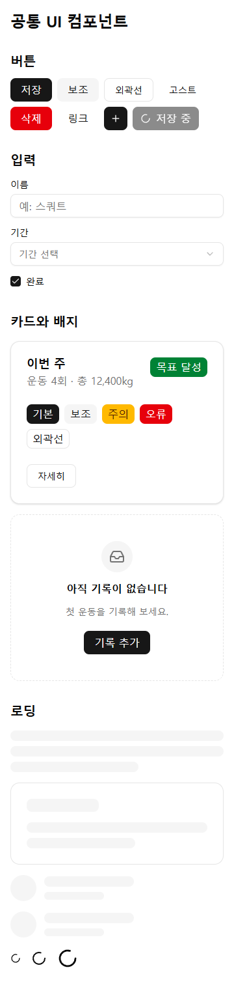
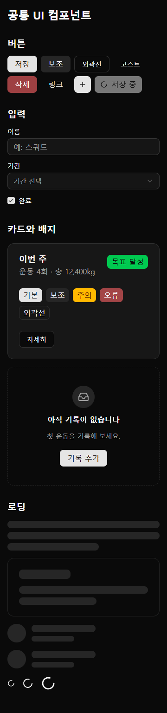
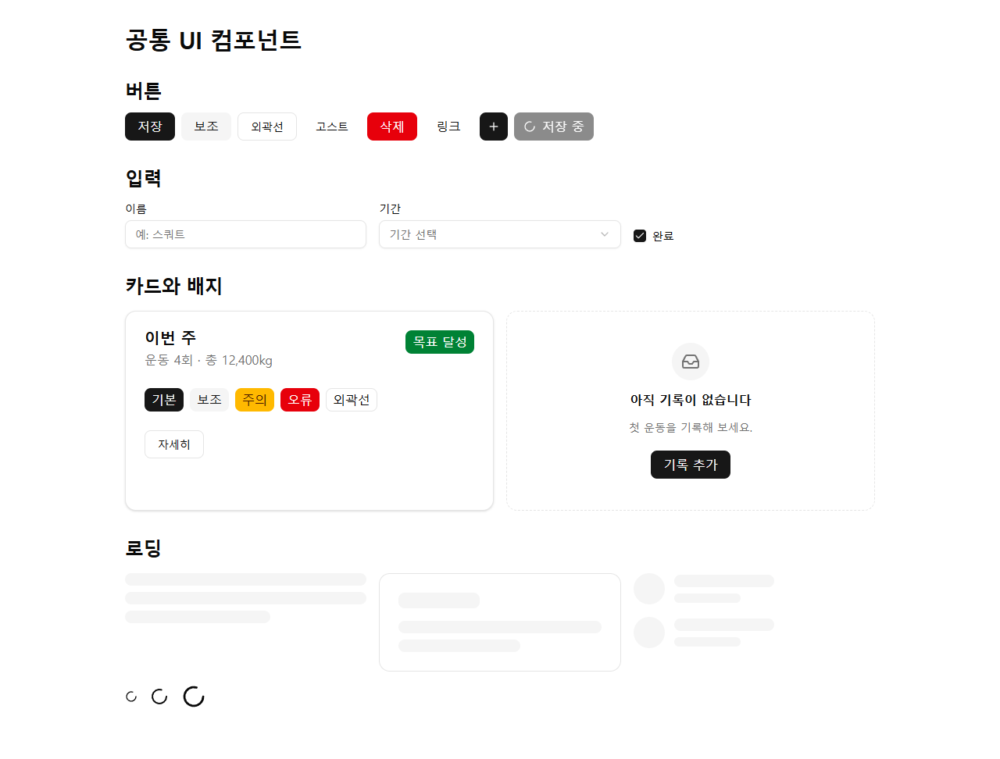
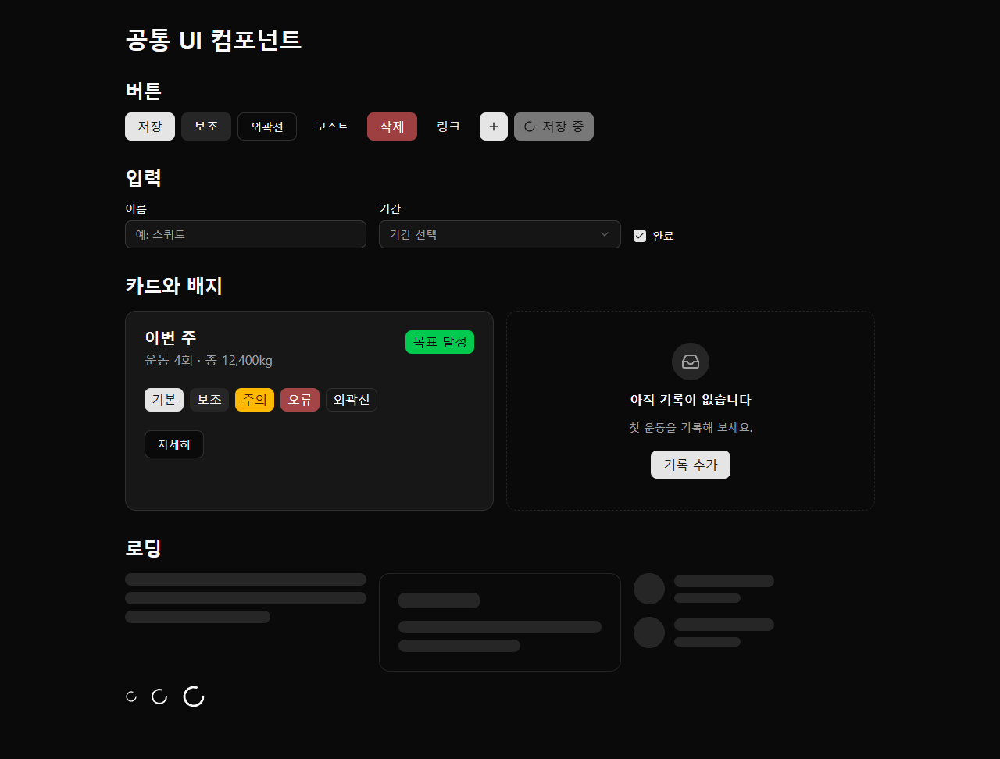

# 공통 UI 컴포넌트

8개 앱이 같은 모양으로 쓰는 shadcn/ui 기본 컴포넌트다(#123, [ADR-0007](adr/0007-shadcn-ui-icons-emoji.md)). 원본은 `templates/ui/`이고, 앱의 `frontend/src/components/ui/`에 중앙 관리 파일로 동기화된다. 화면 규칙은 [디자인 시스템](design-system.md)을 따른다.

## 목록

| 파일 | 내보내는 것 | 메모 |
|---|---|---|
| `button.tsx` | `Button`, `buttonVariants` | `variant`: default, secondary, outline, ghost, destructive, link. `size`: default, sm, lg, icon. `asChild`로 링크를 버튼 모양으로 |
| `input.tsx` | `Input` | `aria-invalid`이면 오류 테두리 |
| `label.tsx` | `Label` | 입력과 `htmlFor`로 연결한다 |
| `checkbox.tsx` | `Checkbox` | 상자는 16px, 터치 기기에서는 보이지 않는 44px 누름 영역 |
| `select.tsx` | `Select`, `SelectTrigger`, `SelectValue`, `SelectContent`, `SelectItem`, `SelectGroup`, `SelectLabel`, `SelectSeparator` | 키보드로 열고 고를 수 있다 |
| `card.tsx` | `Card`, `CardHeader`, `CardTitle`, `CardDescription`, `CardAction`, `CardContent`, `CardFooter` | `CardTitle`은 기본 `h3`, `asHeading`으로 단계를 맞춘다 |
| `badge.tsx` | `Badge`, `badgeVariants` | `variant`: default, secondary, success, warning, destructive, outline |
| `sonner.tsx` | `Toaster`, `toast` | 앱 루트에 `<Toaster />`를 한 번 둔다. 테마는 `<html>`의 `light`·`dark` 클래스, 없으면 시스템 설정 |
| `skeleton.tsx` | `Skeleton`, `SkeletonText`, `SkeletonCard`, `SkeletonList` | 화면 읽기 프로그램에서 숨긴다. 불러오는 영역에 `aria-busy`와 이름을 단다 |
| `spinner.tsx` | `Spinner`, `spinnerVariants` | `size`: sm(16px), md(24px), lg(32px). `role="status"`, 기본 이름 "불러오는 중" |
| `empty-state.tsx` | `EmptyState` | 아이콘, 제목, 설명, 다음 행동(버튼). 제목 단계는 `headingLevel` |
| `dialog.tsx` | `Dialog`, `DialogTrigger`, `DialogContent`, `DialogHeader`, `DialogFooter`, `DialogTitle`, `DialogDescription`, `DialogClose` | 모달. [공통 레이아웃](layout.md) |
| `sheet.tsx` | `Sheet`, `SheetTrigger`, `SheetContent`(`side`), `SheetHeader`, `SheetFooter`, `SheetTitle`, `SheetDescription`, `SheetClose` | 가장자리 패널 |
| `drawer.tsx` | `Drawer`, `DrawerTrigger`, `DrawerContent`, `DrawerHeader`, `DrawerFooter`, `DrawerTitle`, `DrawerDescription`, `DrawerClose` | 아래 패널(vaul). 열면 포커스가 안으로 이동 |
| `dropdown-menu.tsx` | `DropdownMenu`, `DropdownMenuTrigger`, `DropdownMenuContent`, `DropdownMenuItem`, `DropdownMenuCheckboxItem`, `DropdownMenuRadioGroup`, `DropdownMenuRadioItem`, `DropdownMenuLabel`, `DropdownMenuSeparator`, `DropdownMenuGroup` | 버튼 메뉴 |
| `../lib/utils.ts` | `cn` | 클래스 합치기 (shadcn/ui 관례) |

컴포넌트마다 `*.test.tsx`(Vitest, Testing Library)가 함께 동기화되어 앱의 `npm test`에서 실행된다.

## 앱에 켜기

컴포넌트는 레지스트리에서 `features.ui`가 `true`인 앱에만 동기화한다. 의존성이 없는 앱에 넣으면 빌드가 깨지기 때문이다. 디자인 시스템 적용(#126)으로 8개 앱 모두 `true`다. 새 앱이나 기능을 끈 앱은 다음 순서로 켠다.

1. **[사용자 승인]** 의존성 설치: `radix-ui@1.7.0 sonner@2.0.8 vaul@1.1.2 tw-animate-css@1.4.0` (모두 [의존성 정책](dependency-policy.md) 표의 고정 버전, `--ignore-scripts`). `clsx`, `tailwind-merge`, `class-variance-authority`, `lucide-react`도 있어야 한다.
2. `frontend/src/index.css`에 `@import 'tw-animate-css';`를 추가한다([디자인 토큰 README](../packages/design-tokens/README.md)).
3. 앱의 기존 `components/ui/` 파일 중 이름이 겹치는 것은 공통 컴포넌트로 바꾸거나 다른 폴더로 옮긴다. 동기화가 같은 경로를 덮어쓴다.
4. `registry/projects.json`에서 그 앱의 `features.ui`를 `true`로 바꾸는 PR을 중앙에 연다. 다음 동기화 PR에 컴포넌트가 들어간다.

새 프로젝트는 처음부터 `features.ui: true`로 등록한다. 스캐폴드의 `package.json`에 위 의존성이 들어 있다.

## 확인한 결과 (2026-10-22)

가상 슬롯 99 앱에 workout-memo의 설치본과 위 패키지(작업용 임시 폴더에 `--ignore-scripts`로 설치)를 연결해 확인했다.

- 테스트 23개, `tsc`, ESLint 통과
- 설치된 Chrome에서 버튼·배지·라벨·설명 글자 대비 측정: 라이트 최소 4.74:1, 다크 최소 6.02:1 (WCAG AA 4.5:1 이상)
- 터치 기기 에뮬레이션(360px): 버튼·입력·선택 상자 높이 44px, 체크박스 누름 영역 44px
- 키보드로 선택 상자를 열고 고르기, 토스트 표시
- 360px·1280px, 라이트·다크 모두 가로 넘침 0px

| | 라이트 | 다크 |
|---|---|---|
| 360px |  |  |
| 1280px |  |  |
