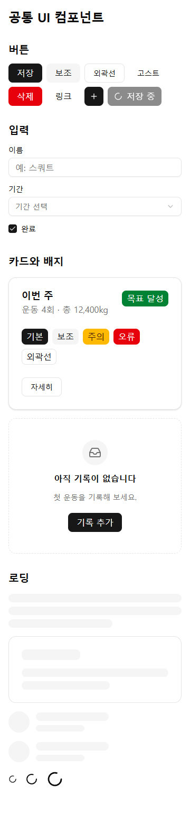
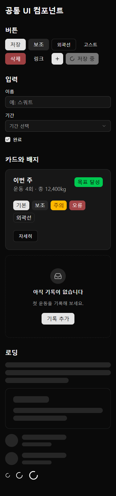
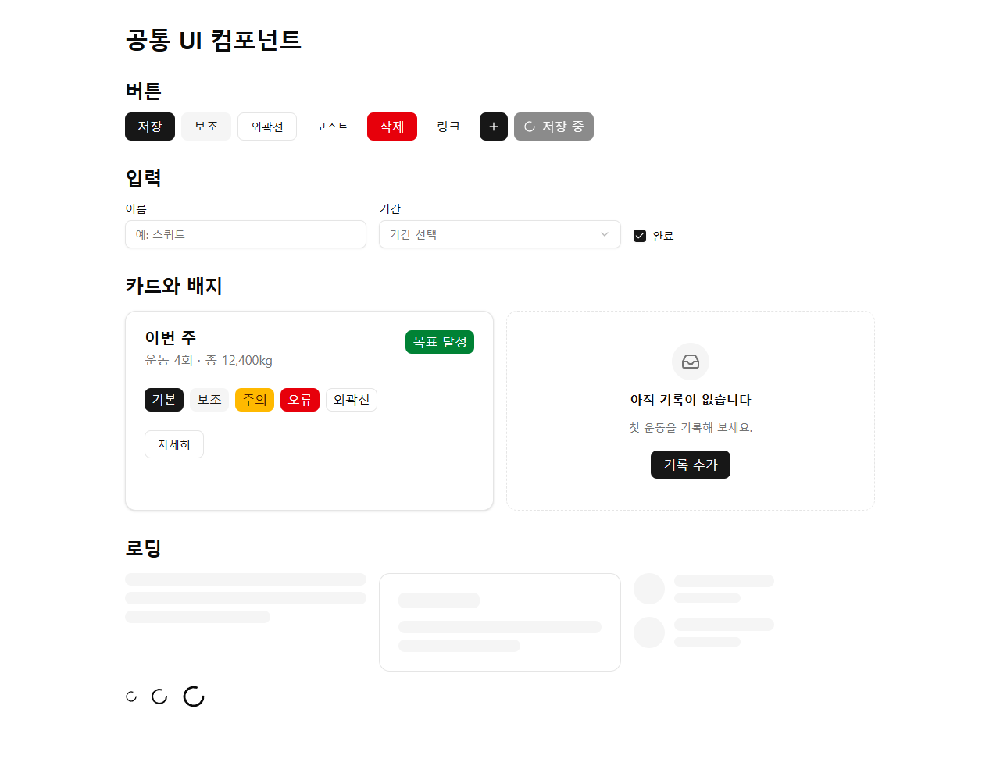
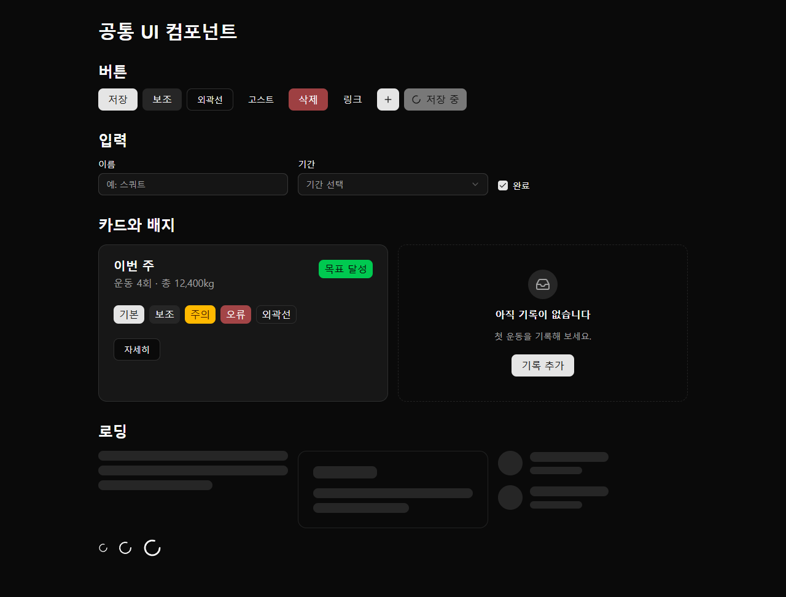

# Shared UI components

These are the shadcn/ui base components all 8 apps use in the same form (#123, [ADR-0007](adr/0007-shadcn-ui-icons-emoji.md)). The source is `templates/ui/`, and it is synced as centrally managed files to each app's `frontend/src/components/ui/`. Screen rules follow the [design system](design-system.md).

## List

| File | Exports | Note |
|---|---|---|
| `button.tsx` | `Button`, `buttonVariants` | `variant`: default, secondary, outline, ghost, destructive, link. `size`: default, sm, lg, icon. Use `asChild` to make a link look like a button |
| `input.tsx` | `Input` | Error border when `aria-invalid` |
| `label.tsx` | `Label` | Connect it to the input with `htmlFor` |
| `checkbox.tsx` | `Checkbox` | The box is 16px, and on touch devices there is an invisible 44px press area |
| `select.tsx` | `Select`, `SelectTrigger`, `SelectValue`, `SelectContent`, `SelectItem`, `SelectGroup`, `SelectLabel`, `SelectSeparator` | Can be opened and chosen with the keyboard |
| `card.tsx` | `Card`, `CardHeader`, `CardTitle`, `CardDescription`, `CardAction`, `CardContent`, `CardFooter` | `CardTitle` is `h3` by default; match the level with `asHeading` |
| `badge.tsx` | `Badge`, `badgeVariants` | `variant`: default, secondary, success, warning, destructive, outline |
| `sonner.tsx` | `Toaster`, `toast` | Place `<Toaster />` once at the app root. The theme follows the `light` or `dark` class on `<html>`, or the system setting if there is none |
| `skeleton.tsx` | `Skeleton`, `SkeletonText`, `SkeletonCard`, `SkeletonList` | Hidden from screen readers. Put `aria-busy` and a name on the loading area |
| `spinner.tsx` | `Spinner`, `spinnerVariants` | `size`: sm (16px), md (24px), lg (32px). `role="status"`, default name "Loading" |
| `empty-state.tsx` | `EmptyState` | Icon, title, description, next action (button). The title level is `headingLevel` |
| `dialog.tsx` | `Dialog`, `DialogTrigger`, `DialogContent`, `DialogHeader`, `DialogFooter`, `DialogTitle`, `DialogDescription`, `DialogClose` | Modal. [Shared layout](layout.md) |
| `confirm-dialog.tsx` | `ConfirmDialog` | Asks before an irreversible action such as delete (#311). Use it instead of the browser `confirm()`. Open it with `trigger` (the opening button) or `open` and `onOpenChange`. If opened without a `trigger`, there is nowhere for focus to return after closing, so specify it with `returnFocusRef` (#356). If `onConfirm` returns a Promise, the buttons are blocked until it finishes; on success it closes, and on failure it stays open. The default labels are "Delete" and "Cancel", and when `destructive` (default `true`), the confirm button has the destructive look |
| `notice.tsx` | `Notice` | In-screen notification (#311). `role="status"` when `notice.kind` is `status`, `role="alert"` when `error`. Renders nothing if there is no value. For passing notifications not tied to one place, use `toast` |
| `sheet.tsx` | `Sheet`, `SheetTrigger`, `SheetContent` (`side`), `SheetHeader`, `SheetFooter`, `SheetTitle`, `SheetDescription`, `SheetClose` | Edge panel |
| `drawer.tsx` | `Drawer`, `DrawerTrigger`, `DrawerContent`, `DrawerHeader`, `DrawerFooter`, `DrawerTitle`, `DrawerDescription`, `DrawerClose` | Bottom panel (vaul). Focus moves inside when opened |
| `dropdown-menu.tsx` | `DropdownMenu`, `DropdownMenuTrigger`, `DropdownMenuContent`, `DropdownMenuItem`, `DropdownMenuCheckboxItem`, `DropdownMenuRadioGroup`, `DropdownMenuRadioItem`, `DropdownMenuLabel`, `DropdownMenuSeparator`, `DropdownMenuGroup` | Button menu |
| `../lib/utils.ts` | `cn` | Merges class names (shadcn/ui convention) |

A `*.test.tsx` (Vitest, Testing Library) for each component is synced along with it and runs in the app's `npm test`.

## Loading screens

While loading, feature screens do not leave a blank screen or only text ("Loading…"); they use the shared components (#312).

| Situation | What to use |
|---|---|
| Loading a list or table for the first time | `SkeletonList` (row shape), or `SkeletonCard` for a card list. Put `aria-busy="true"` and a name (`aria-label`) on the loading area |
| A block of text | `SkeletonText` |
| Waiting for a save or delete after pressing a button | `Spinner size="sm"` inside the button, and `disabled`. `ConfirmDialog` does this by itself |
| When the whole screen would have to be blocked | Do not use it. Show the existing content as is and mark only the parts that change |

- If loading fails, show the reason with `Notice` (`role="alert"`).

## Shared helpers

| File | Exports | Note |
|---|---|---|
| `frontend/src/lib/api.ts` | `requestJson`, `RequestError` | App API requests (#310). On success, the JSON body, or `undefined` for `204`. On failure, a `RequestError` carrying the server's `error` message and `status` (a connection failure is "Cannot reach the server", with no `status`). The server-side counterpart is `backend/src/standard/http.ts` (#309) |
| `frontend/src/lib/use-notice.ts` | `useNotice`, `errorText`, `NoticeValue` | `const { notice, status, error, clear } = useNotice()`. `error(e)` extracts the message from the thrown value (the server's text for a `RequestError`). On screen, use `<Notice notice={notice} />` |
| `frontend/src/health.ts` | `Health`, `healthText` | Server status display text. 7 apps were using the same file. workout-memo does not use it, so it was left out with `allowedDifferences` |

- Screen code does not call `fetch` directly; it uses `requestJson`. To handle cases differently by status, such as when a deleted item is already gone (`404`), branch with `error instanceof RequestError && error.status === 404`.
- Move study-log and plan-routine's `frontend/src/api.ts` and workout-memo's per-screen `fetch` to `lib/api.ts` in the app repo (see the per-app guidance in the change log below).

## Turning it on for an app

Components are synced only to apps whose `features.ui` is `true` in the registry, because adding them to an app without the dependencies would break the build. With the design system rollout (#126), all 8 apps are `true`. For a new app or an app that has the feature off, turn it on in this order.

1. **[User approval]** Install dependencies: `radix-ui@1.7.0 sonner@2.0.8 vaul@1.1.2 tw-animate-css@1.4.0` (all pinned versions from the table in the [dependency policy](dependency-policy.md), `--ignore-scripts`). `clsx`, `tailwind-merge`, `class-variance-authority`, and `lucide-react` must also be present.
2. Add `@import 'tw-animate-css';` to `frontend/src/index.css` ([design tokens README](../packages/design-tokens/README.md)).
3. For any of the app's existing `components/ui/` files whose names collide, replace them with the shared components or move them to another folder. Sync overwrites the same path.
4. Open a PR in the center that changes the app's `features.ui` to `true` in `registry/projects.json`. The components come in with the next sync PR.

A new project is registered with `features.ui: true` from the start. The scaffold's `package.json` includes the dependencies above.

## Verification results (2026-10-22)

We connected workout-memo's installed copy and the packages above (installed in a temporary working folder with `--ignore-scripts`) to a virtual slot 99 app and verified.

- 23 tests, `tsc`, and ESLint pass
- Text contrast of buttons, badges, labels, and descriptions measured in the installed Chrome: light minimum 4.74:1, dark minimum 6.02:1 (WCAG AA 4.5:1 or more)
- Touch device emulation (360px): buttons, inputs, and select boxes are 44px tall, and the checkbox press area is 44px
- Opening and choosing in the select box with the keyboard, toast display
- 0px horizontal overflow at 360px and 1280px, in both light and dark

| | Light | Dark |
|---|---|---|
| 360px |  |  |
| 1280px |  |  |
